# The Model That Doesn't Know: Open-Set Image Classification & Uncertainty Estimation

An image classification and Out-of-Distribution (OOD) detection system built around an ImageNet-pretrained **ResNet-18** fine-tuned on **6 known categories** (`airplane`, `automobile`, `bird`, `cat`, `dog`, `ship`), equipped with **7 uncertainty estimation methods**, **post-hoc temperature calibration**, **corruption robustness stress-testing**, and **visual explainability (t-SNE + Grad-CAM)**.

---

## 1. Problem Formulation & Architecture

Standard neural classifiers trained with Cross-Entropy loss apply a Softmax layer over $K$ known logits:

$$P(y = i \mid x) = \frac{e^{z_i}}{\sum_{j=1}^{K} e^{z_j}}$$

Because Softmax normalizes probabilities to sum to $1.0$ and exponentiates raw logits, unfamiliar inputs from unseen categories are frequently assigned high confidence toward whichever known class shares superficial visual textures. To solve this, our pipeline decouples **feature extraction ($f_\theta(x) \in \mathbb{R}^{512}$)** and **classification ($g_\phi(f) \in \mathbb{R}^6$)** from an **Uncertainty Gatekeeper $S(x)$** tuned strictly on validation in-distribution data.

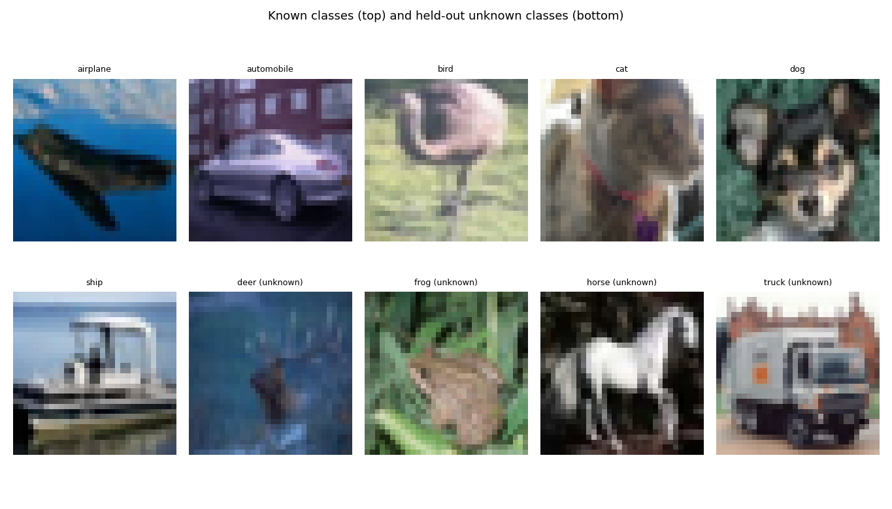

### Dataset & Preprocessing Pipeline
* **Dataset:** CIFAR-10 (`torchvision`), partitioned into **In-Distribution (ID)** and **Out-of-Distribution (OOD)** splits.
* **Known Categories (6):** `airplane, automobile, bird, cat, dog, ship`.
* **Near-OOD Unknown Categories (4):** `deer, frog, horse, truck` — deliberately held out from training and validation to test semantic similarity confusion (`truck` vs `automobile`, `deer`/`horse` vs `cat`/`dog`).
* **Far-OOD Set:** `1,000` synthetic Gaussian noise images.
* **Split Sizes:** Train: `27000` | Validation (ID only, for Temperature $T$ & 5th-percentile threshold $\tau$): `3000` | Unseen Known Test: `6000` | Unknown Test: `4000`.
* **Preprocessing:** Cast to `[0, 1]`, bilinear upsampling `32×32 → 64×64` to match pretrained ResNet receptive fields, ImageNet channel normalization (`mean=[0.485, 0.456, 0.406]`, `std=[0.229, 0.224, 0.225]`), plus random horizontal flips and reflection-padded crops during training.

---

## 2. Classification & Confidence Calibration on Unseen Known Images

* **Unseen Known Test Accuracy:** **93.02%** across `6000` test images.
* **Confidence Calibration:** Post-hoc Temperature Scaling ($z_i / T$) fitted via L-BFGS on validation Negative Log-Likelihood (NLL) found optimal temperature **$T = 1.288$**, reducing Expected Calibration Error (ECE, 15 bins) from **0.0204 → 0.0075** and NLL from **0.1986 → 0.1914** without altering top-1 accuracy.

| Confusion Matrix | Training Curves |
| :---: | :---: |
| 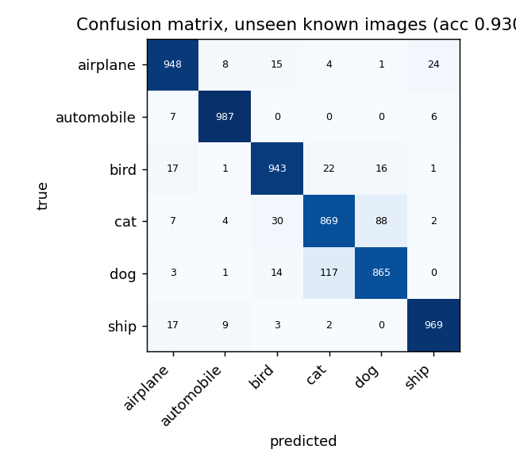 | 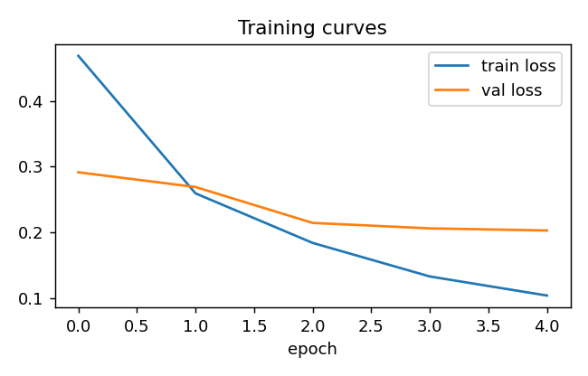 |

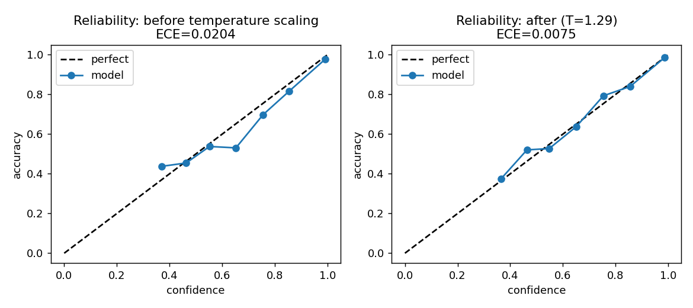

---

## 3. Uncertainty & Out-of-Distribution (OOD) Detection Benchmark (7 Methods)

We compare 7 scoring functions (oriented so higher score = higher familiarity/confidence):
1. **MSP (Baseline):** $\max_i P(y=i \mid x)$
2. **MSP + Temperature Scaling:** $\max_i \text{Softmax}(z / T)_i$
3. **Negative Shannon Entropy:** $\sum_i P(y=i \mid x) \log P(y=i \mid x)$
4. **Max Logit:** $\max_i z_i$ (preserves pre-softmax magnitude)
5. **Energy Score:** $\log \sum_i e^{z_i}$ (helmholtz free energy of logits)
6. **Mahalanobis Distance:** $-\min_c (f - \mu_c)^\top \Sigma^{-1} (f - \mu_c)$ in 512-D feature space
7. **Monte Carlo (MC) Dropout:** Negative entropy of mean softmax across 20 stochastic forward passes ($p=0.3$)

### Near-OOD Detection (`deer`, `frog`, `horse`, `truck` vs Known Test)

|  | AUROC | AUPR_out | FPR95 |
|---|---|---|---|
| MSP (baseline) | 0.787 | 0.672 | 0.793 |
| MSP + temp. scaling | 0.791 | 0.681 | 0.775 |
| Negative entropy | 0.794 | 0.698 | 0.725 |
| Max logit | 0.803 | 0.710 | 0.717 |
| Energy | 0.803 | 0.710 | 0.718 |
| Mahalanobis (features) | 0.618 | 0.503 | 0.895 |
| MC dropout (neg. entropy) | 0.795 | 0.699 | 0.723 |

### Far-OOD Detection (Gaussian Noise vs Known Test)

|  | AUROC | AUPR_out | FPR95 |
|---|---|---|---|
| MSP (baseline) | 0.989 | 0.905 | 0.020 |
| MSP + temp. scaling | 0.992 | 0.919 | 0.007 |
| Negative entropy | 0.995 | 0.918 | 0.000 |
| Max logit | 0.993 | 0.893 | 0.000 |
| Energy | 0.990 | 0.854 | 0.000 |
| Mahalanobis (features) | 0.954 | 0.598 | 0.325 |
| MC dropout (neg. entropy) | 0.995 | 0.918 | 0.000 |

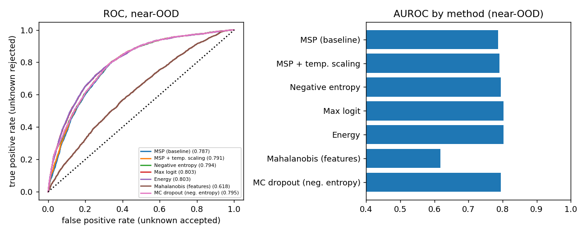
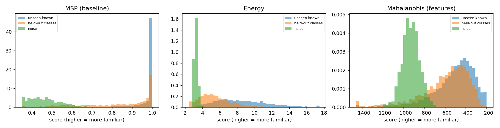
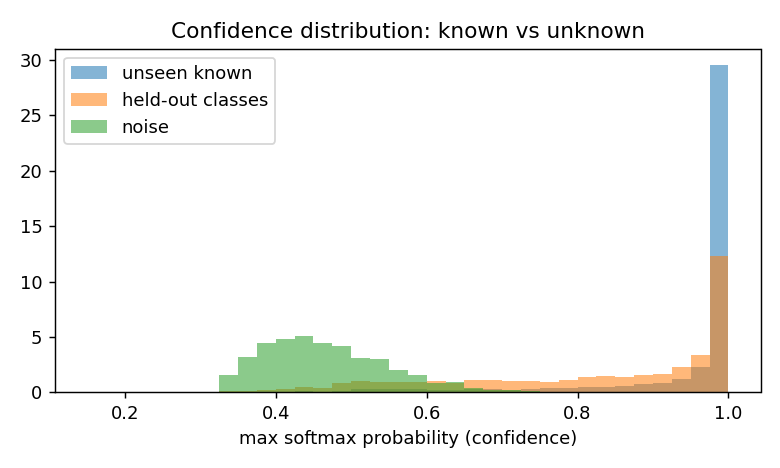

---

## 4. Classification Behavior: Before vs. After Uncertainty Handling

Using the **5th percentile of validation known scores** as the rejection threshold $\tau$ (targeting ~95% TPR on known inputs without peeking at OOD data):

| method | known_kept | acc_on_kept | wrong_known_caught | unknown_rejected | noise_rejected |
|---|---|---|---|---|---|
| No handling (always answer) | 1.000 | 0.930 | 0.000 | 0.000 | 0.000 |
| MSP (baseline) | 0.948 | 0.953 | 0.360 | 0.216 | 0.982 |
| MSP + temp. scaling | 0.950 | 0.952 | 0.348 | 0.225 | 0.993 |
| Negative entropy | 0.945 | 0.953 | 0.370 | 0.287 | 1.000 |
| Max logit | 0.949 | 0.947 | 0.279 | 0.288 | 1.000 |
| Energy | 0.951 | 0.944 | 0.243 | 0.279 | 1.000 |
| Mahalanobis (features) | 0.956 | 0.930 | 0.038 | 0.095 | 0.567 |
| MC dropout (neg. entropy) | 0.945 | 0.953 | 0.368 | 0.292 | 1.000 |

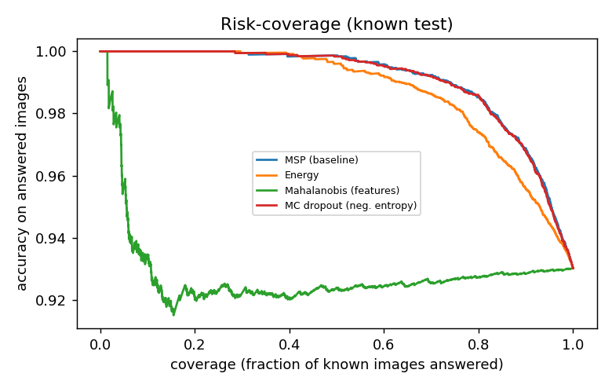
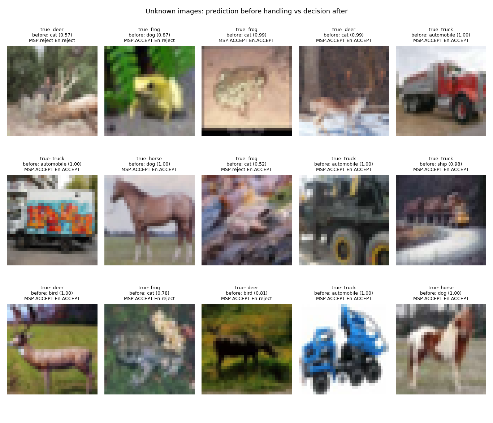

---

## 5. Failure Analysis & Visual Explainability (t-SNE & Grad-CAM)

### Per-Unknown-Class Breakdown (Which OOD Classes Fool the Gatekeeper?)

| unknown_class | n | accepted_MSP | accepted_Energy | accepted_Mahalanobis | mostly_called |
|---|---|---|---|---|---|
| deer | 1000 | 0.722 | 0.705 | 0.960 | bird (40%) |
| frog | 1000 | 0.771 | 0.697 | 0.957 | cat (56%) |
| horse | 1000 | 0.771 | 0.686 | 0.796 | dog (65%) |
| truck | 1000 | 0.871 | 0.795 | 0.906 | automobile (79%) |

### False Rejections by Known Class

| known_class | recall | rejected_MSP | rejected_Energy |
|---|---|---|---|
| airplane | 0.948 | 0.038 | 0.054 |
| automobile | 0.987 | 0.009 | 0.015 |
| bird | 0.943 | 0.053 | 0.031 |
| cat | 0.869 | 0.104 | 0.098 |
| dog | 0.865 | 0.087 | 0.050 |
| ship | 0.969 | 0.022 | 0.046 |

| High-Confidence Known Errors | Missed Unknowns (Accepted OOD Inputs) |
| :---: | :---: |
| 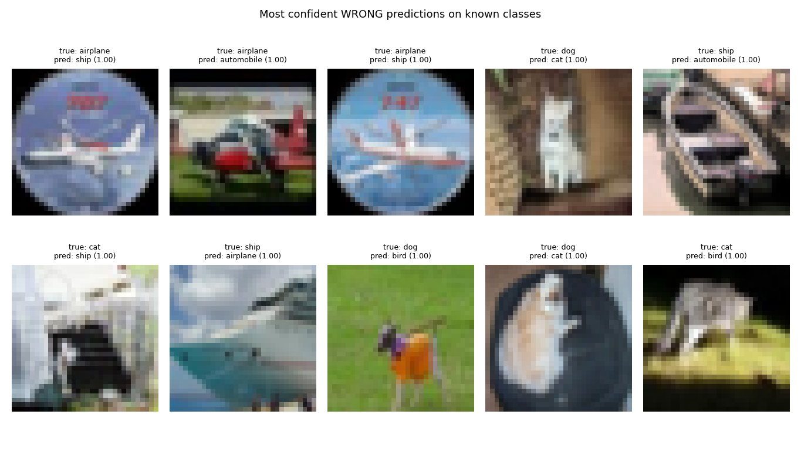 | 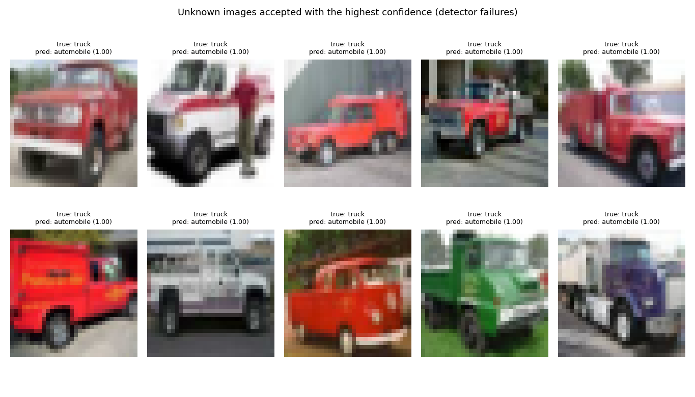 |

| 512-D Feature Space t-SNE | Spatial Activation Heatmaps (Grad-CAM) |
| :---: | :---: |
| 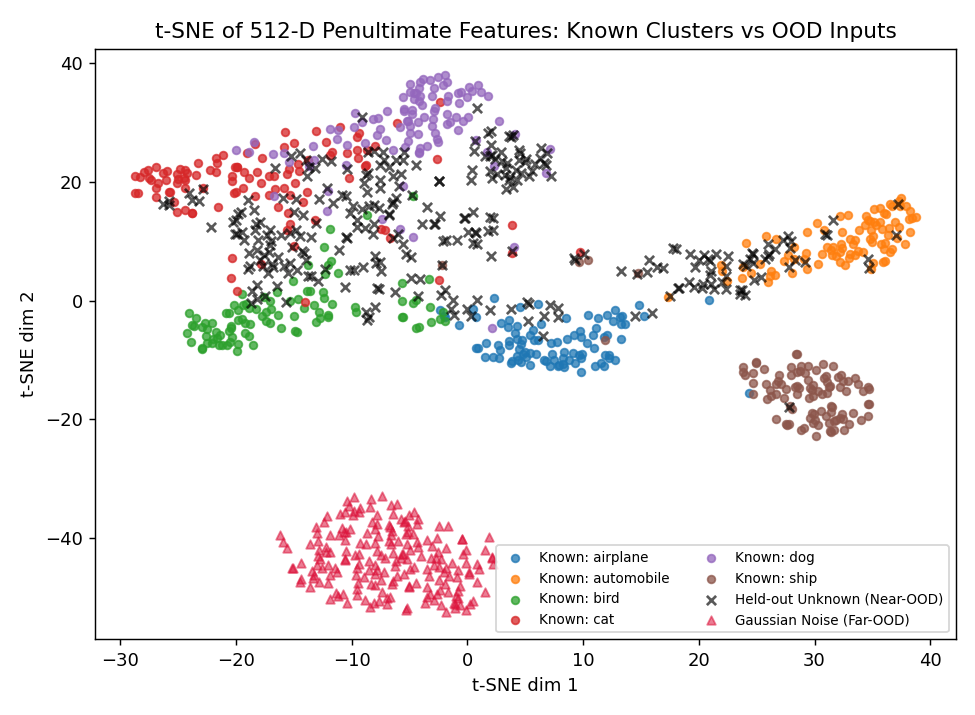 | 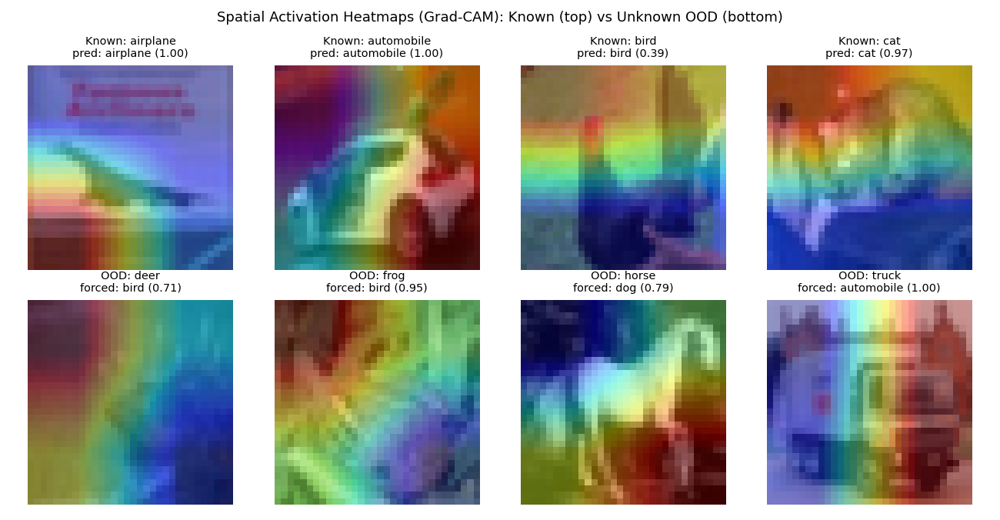 |

---

## 6. Robustness Against Image Corruptions

We evaluate model accuracy, calibration, false-rejection rate, and OOD AUROC across 4 corruption types (`gaussian_noise`, `blur`, `low_res`, `darken`) at 3 severity levels each:

| condition | accuracy | ECE | ECE_temp_scaled | mean_conf | known_rejected_MSP | AUROC_MSP | known_rejected_Energy | AUROC_Energy | known_rejected_Mahalanobis | AUROC_Mahalanobis |
|---|---|---|---|---|---|---|---|---|---|---|
| clean | 0.930 | 0.020 | 0.008 | 0.949 | 0.052 | 0.787 | 0.049 | 0.803 | 0.044 | 0.618 |
| gaussian_noise 0.05 | 0.839 | 0.064 | 0.030 | 0.902 | 0.111 | 0.738 | 0.145 | 0.727 | 0.042 | 0.582 |
| gaussian_noise 0.1 | 0.579 | 0.206 | 0.151 | 0.784 | 0.280 | 0.625 | 0.372 | 0.605 | 0.063 | 0.553 |
| gaussian_noise 0.2 | 0.310 | 0.328 | 0.265 | 0.638 | 0.592 | 0.521 | 0.741 | 0.525 | 0.214 | 0.530 |
| blur 0.8 | 0.847 | 0.062 | 0.031 | 0.907 | 0.106 | 0.755 | 0.121 | 0.754 | 0.040 | 0.553 |
| blur 1.5 | 0.519 | 0.278 | 0.222 | 0.798 | 0.262 | 0.584 | 0.385 | 0.537 | 0.047 | 0.506 |
| blur 2.5 | 0.355 | 0.375 | 0.310 | 0.730 | 0.373 | 0.489 | 0.588 | 0.435 | 0.051 | 0.435 |
| low_res 2 | 0.609 | 0.247 | 0.204 | 0.856 | 0.180 | 0.679 | 0.306 | 0.721 | 0.152 | 0.551 |
| low_res 4 | 0.363 | 0.473 | 0.420 | 0.835 | 0.202 | 0.601 | 0.412 | 0.634 | 0.412 | 0.538 |
| low_res 8 | 0.310 | 0.451 | 0.386 | 0.761 | 0.328 | 0.609 | 0.701 | 0.625 | 0.359 | 0.553 |
| darken 0.6 | 0.910 | 0.025 | 0.008 | 0.935 | 0.068 | 0.767 | 0.080 | 0.782 | 0.024 | 0.611 |
| darken 0.4 | 0.878 | 0.034 | 0.010 | 0.909 | 0.098 | 0.744 | 0.145 | 0.758 | 0.014 | 0.588 |
| darken 0.2 | 0.680 | 0.131 | 0.074 | 0.811 | 0.241 | 0.641 | 0.472 | 0.657 | 0.006 | 0.512 |

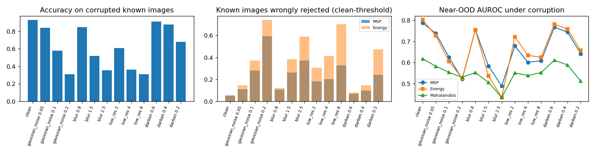

---

## 7. Key Empirical Observations
* Fine-tuned ResNet-18 reaches **93.0%** accuracy on 6000 unseen known images; weakest class: **dog** (86.5% recall).
* Calibration: ECE 0.020 → 0.008 after temperature scaling (T = 1.29); mean confidence 0.949 → 0.930 vs accuracy 0.930.
* Near-OOD (held-out classes): best method **Energy** (AUROC 0.803); worst **Mahalanobis (features)** (AUROC 0.618); baseline MSP 0.787.
* Far-OOD (noise): best method **Negative entropy** (AUROC 0.995).
* Without handling, 100 % of the 4000 unknown images receive a known label. With MSP rejection 21.6% are rejected, with Energy 27.9%, with Mahalanobis 9.5% (while keeping ~95% of known images).
* Hardest held-out class for the MSP detector: **truck** (87.1% accepted, mostly called automobile (79%)).
* Under the worst tested corruption for accuracy (**gaussian_noise 0.2**) accuracy falls to 31.0% and the MSP detector rejects 59.2% of known images.

---

## 8. Limitations
* **Near-OOD Semantic Overlap at Low Resolution:** Native CIFAR-10 images are $32 \times 32$ upsampled to $64 \times 64$. Fine-grained features separating `truck` from `automobile` or `deer`/`horse` from `dog`/`cat` are blurred, bounding post-hoc OOD AUROC.
* **Static Threshold Shift Under Covariate Shift:** Thresholds $\tau$ calibrated on clean validation data reject a higher proportion of valid known inputs when images suffer severe blur or noise (aleatoric uncertainty).
* **Gaussian Assumption in Mahalanobis:** Class-conditional feature distributions in ResNet-18 are not strictly multivariate Gaussian with identical covariance across classes.

---

## 9. How to Reproduce & Run the Real-Time Gradio Demo
```bash
pip install -r requirements.txt
# 1. Run uncertainty_classifier.ipynb on Colab (GPU) or via nbconvert:
jupyter nbconvert --to notebook --execute --inplace uncertainty_classifier.ipynb
# 2. Launch the interactive Gradio web app (with Grad-CAM heatmap & multi-detector diagnostics):
python app.py
```
